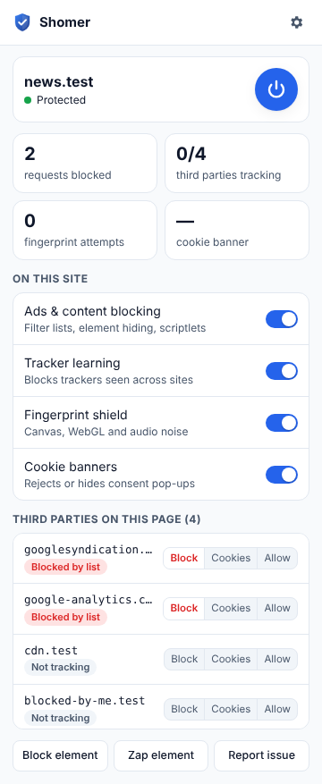
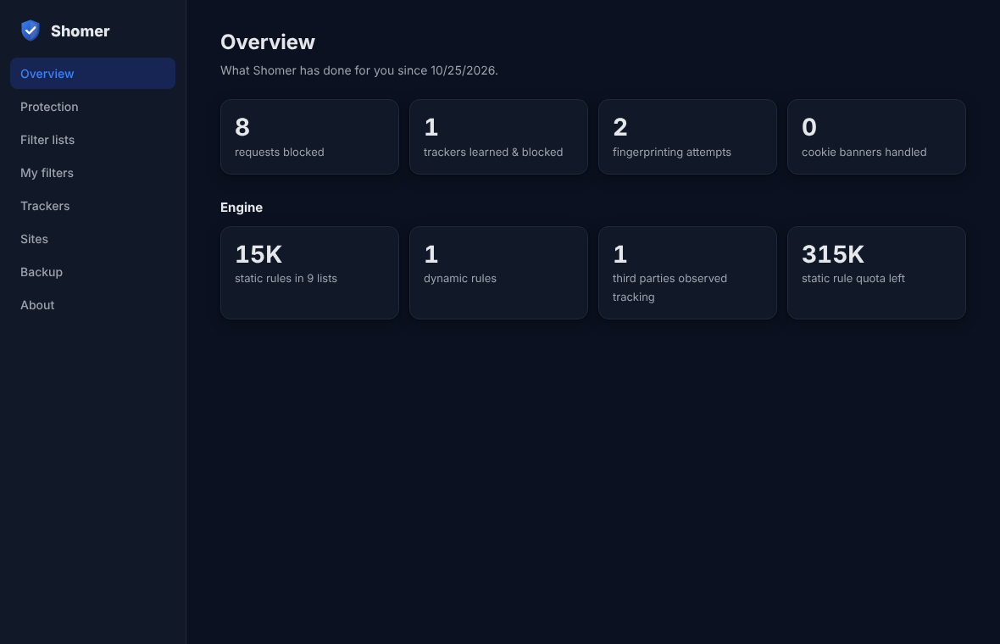
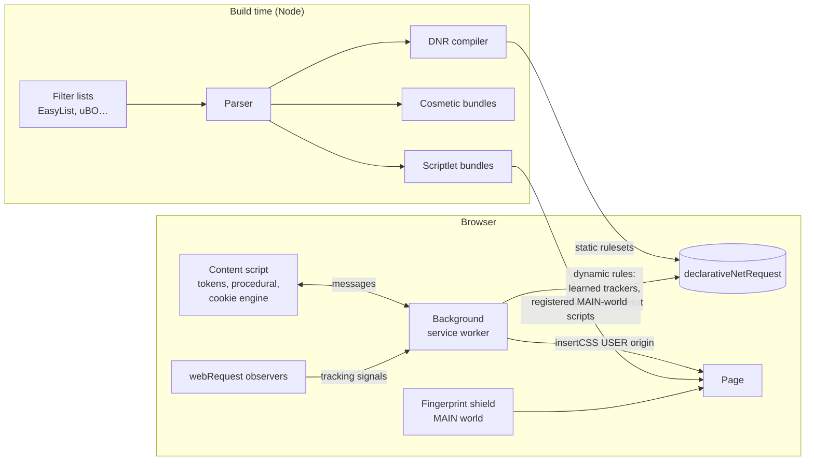

<div align="center">


# Shomer · שומר

**An all-in-one, open-source privacy shield for Chrome and Firefox.**
Blocks ads and trackers, learns new trackers on its own, defeats browser fingerprinting, and rejects cookie banners — in one Manifest V3 extension.

[](https://github.com/harelhz/shomer/actions/workflows/ci.yml)
[](LICENSE)


</div>

---

_Shomer_ (Hebrew: שומר, "guardian") combines what usually takes four extensions:

| You'd normally install…    | …for                                                                                    | Shomer's module                                             |
| -------------------------- | --------------------------------------------------------------------------------------- | ----------------------------------------------------------- |
| uBlock Origin              | Blocking ads and trackers with filter lists, element hiding, scriptlets, element picker | **Ads & content blocking**                                  |
| Privacy Badger             | Learning trackers by their behaviour, Global Privacy Control                            | **Tracker learning**                                        |
| CanvasBlocker              | Protection against canvas / WebGL / audio fingerprinting                                | **Fingerprint shield**                                      |
| I don't care about cookies | Getting rid of cookie consent pop-ups                                                   | **Cookie banners** (but it clicks _reject_, never _accept_) |

It is an independent implementation, written from scratch in TypeScript, built natively for Manifest V3.

<p align="center">
  
  &nbsp;&nbsp;
  
</p>

## Features

### 🧱 Ads & content blocking

- Compiles **EasyList, EasyPrivacy, uBlock filters (+ Privacy, + Cookie notices) and Peter Lowe's list** — about 156,000 filters — into ~15,000 native `declarativeNetRequest` rules at build time, using its own ABP/uBO filter compiler. 97.7% of filters are converted; the rest can't be expressed in MV3 (mostly `$popup`) and are reported, not silently dropped.
- **Cosmetic filtering** with uBO's "lowly generic" optimisation: the 13,000 class/id-based generic selectors are only injected when a matching class or id actually appears on the page.
- **Procedural filters**: `:has-text()`, `:upward()`, `:matches-css()`, `:xpath()`, `:remove()`, `:style()` and more.
- **36 scriptlets** (uBO-compatible names and arguments) to defuse anti-adblock scripts and auto-reject consent dialogs, injected before any page script runs.
- **Redirect surrogates** (Google Analytics, GPT, AdSense, …) so pages that depend on blocked scripts keep working.
- **Element picker & zapper**, with smart selector generation that skips auto-generated class names.
- **"My filters"** editor with line-by-line error reporting.

### 🧠 Tracker learning

- Watches third parties that **send or set identifying cookies** (estimated by entropy) or **fingerprint** the browser, and blocks them once they've tracked you on **3 different sites** — catching trackers no list knows about.
- **Cookie-blocks** instead of blocking where blocking would break sites (logins, CAPTCHAs, payments, CDNs).
- Understands **multi-domain first parties** (youtube.com ↔ ytimg.com, ynet.co.il ↔ yit.co.il…).
- Per-domain **Block / Cookies / Allow** controls in the popup.
- Sends **Global Privacy Control** (`Sec-GPC: 1` + `navigator.globalPrivacyControl`) and DNT.
- **Clean URLs**: strips `utm_*`, `fbclid`, `gclid` and 50+ other tracking parameters.

### 🎭 Fingerprint shield

- **Deterministic noise** on canvas (`toDataURL`, `toBlob`, `getImageData`, OffscreenCanvas), WebGL `readPixels` and Web Audio — consistent within a page (so double-read detection fails), different on every visit (so it can't link visits).
- **Stealth**: patched functions are Proxies that keep their name and length, and `Function.prototype.toString` still reports `[native code]`.
- **Iframe-bypass resistant**: pristine prototypes from a freshly created `about:blank` frame are protected too, and agree with the parent page.
- **Strict mode** adds DOMRect/TextMetrics noise (font fingerprinting), a generic WebGL renderer and normalised hardware info.
- **WebRTC IP-leak** protection.

### 🍪 Cookie banners

- Rules for **30+ consent platforms** (OneTrust, Cookiebot, Didomi, Quantcast, Usercentrics, TrustArc, Sourcepoint…) that click **reject** or save "necessary only".
- A **heuristic** for unknown banners that finds the refuse button in **15+ languages, including Hebrew**.
- Hides what can't be refused and restores page scrolling. **Never clicks "accept".**

### 🛡️ Built for trust

- **No data collection, no remote code, no network requests of its own.**
- Per-site switches for every module, an allowlist, settings backup/restore.
- Strict TypeScript, 200+ unit tests, end-to-end tests in a real browser, CI.

## Install

> Store listings are coming. Until then, install from source — it takes a minute.

```bash
git clone https://github.com/harelhz/shomer.git
cd shomer
npm ci
npm run build          # downloads the filter lists and builds dist/chrome and dist/firefox
```

- **Chrome / Edge / Brave:** open `chrome://extensions`, enable _Developer mode_, click _Load unpacked_ and pick `dist/chrome`.
- **Firefox (128+):** open `about:debugging#/runtime/this-firefox`, click _Load Temporary Add-on_ and pick `dist/firefox/manifest.json`. Then grant the "access your data for all websites" permission on the welcome page.

## How it works



Manifest V3 doesn't let extensions run their own engine on the network path, so Shomer compiles filters to the browser's native rule format ahead of time and encodes the whole precedence model (lists < per-site switches < learned trackers < your choices < your filters < allowlist) in rule priorities. See **[docs/ARCHITECTURE.md](docs/ARCHITECTURE.md)** for the full design and **[docs/THREAT_MODEL.md](docs/THREAT_MODEL.md)** for the security analysis.

## Development

```bash
npm run lists          # download & compile filter lists (cached for 24h; --offline to use the cache)
npm run build          # build both browsers   (build:chrome / build:firefox / build:dev for sourcemaps)
npm run check          # typecheck + lint + unit tests
npm run test:e2e       # end-to-end tests in Chromium (run build:chrome first)
npm run package        # zip dist/* into artifacts/ for the stores
```

The end-to-end suite starts Chromium with `--host-resolver-rules=MAP * 127.0.0.1`, so _every_ hostname — including real ad domains — resolves to a local test server. That lets the real compiled filter lists, cookie rules and tracker learning be tested offline and deterministically.

### Project layout

```
src/
  background/        service worker: rules, learning, cosmetic engine, messaging
  content/           isolated-world content script, procedural filters, cookie engine
    fingerprint/     MAIN-world fingerprint shield (noise, stealth, frames)
    picker/          element picker & selector generation
  scriptlets/        MAIN-world scriptlet library and runtime
  shared/            code shared by build and runtime: filter parser & compilers, settings, PSL
  data/              cookie-consent rules, yellowlist, multi-domain first parties
  ui/                popup, dashboard, onboarding (no framework)
scripts/             list compiler, bundler, packaging, screenshots
tests/unit/          vitest (node + jsdom)
tests/e2e/           Playwright + real Chromium against a local multi-host server
filters/             Shomer's own filter list
docs/                architecture, threat model, filter syntax
```

## Roadmap

- [ ] Chrome Web Store and Firefox Add-ons listings
- [ ] Localisation (Hebrew first)
- [ ] Worker-scope fingerprinting protection (OffscreenCanvas in Web Workers)
- [ ] Per-site cosmetic filter list updates without a new release
- [ ] More cookie-consent platforms

## Contributing

Bug reports, broken-site reports and pull requests are welcome — see [CONTRIBUTING.md](CONTRIBUTING.md). Please report security issues privately as described in [SECURITY.md](SECURITY.md).

## Credits

Shomer stands on the shoulders of **uBlock Origin** (Raymond Hill and contributors), **Privacy Badger** (EFF), **CanvasBlocker** (kkapsner) and **I don't care about cookies**. No code was copied from them; their designs and documentation were an education.
Filter lists are by the **EasyList** authors, the **uBlock Origin** team and **Peter Lowe**; the Public Suffix List is maintained by **Mozilla**. Each keeps its own license.

## License

[GNU General Public License v3.0 or later](LICENSE). Privacy policy: [PRIVACY.md](PRIVACY.md).
