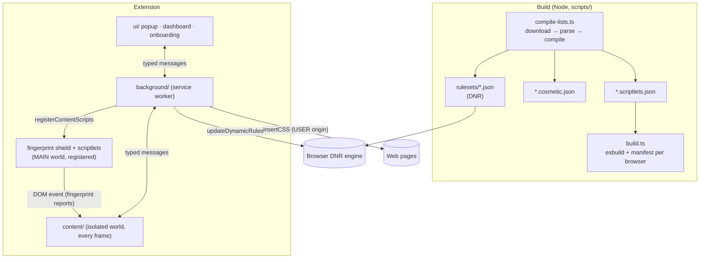
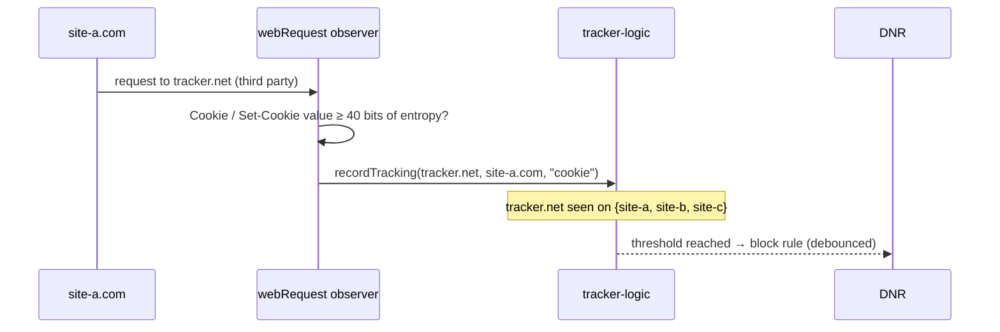

# Shomer architecture

This document explains how Shomer works and why it is built the way it is. It assumes familiarity with browser extensions; the [threat model](THREAT_MODEL.md) covers the security side.

- [Constraints: Manifest V3](#constraints-manifest-v3)
- [Components](#components)
- [Network blocking](#network-blocking)
- [Rule precedence](#rule-precedence)
- [Cosmetic filtering](#cosmetic-filtering)
- [Scriptlets](#scriptlets)
- [Tracker learning](#tracker-learning)
- [Fingerprint shield](#fingerprint-shield)
- [Cookie banners](#cookie-banners)
- [State and the service-worker lifecycle](#state-and-the-service-worker-lifecycle)
- [Testing strategy](#testing-strategy)
- [Numbers](#numbers)

## Constraints: Manifest V3

Manifest V3 shapes everything:

| MV2 extensions could…                                  | In MV3…                                                                 | Shomer's answer                                                                                               |
| ------------------------------------------------------ | ----------------------------------------------------------------------- | ------------------------------------------------------------------------------------------------------------- |
| Block requests from JavaScript (`webRequestBlocking`)  | Only the browser's `declarativeNetRequest` (DNR) can block              | Compile filters into DNR rules ahead of time                                                                  |
| Keep a persistent background page with state in memory | The background is a service worker that's killed when idle              | All state in `chrome.storage`; listeners registered synchronously                                             |
| Download and run new filter lists at any time          | Static rulesets ship with the extension; dynamic rules are capped (30k) | Lists compiled at build time; dynamic rules reserved for learned trackers, user filters and per-site switches |
| Inject arbitrary code strings                          | Only packaged files                                                     | Scriptlet tables are compiled into per-list JS files at build time                                            |

## Components

| Path                       | Role                                                                                                                                                                                                                        |
| -------------------------- | --------------------------------------------------------------------------------------------------------------------------------------------------------------------------------------------------------------------------- |
| `src/shared/filters/`      | Filter **parser**, **DNR compiler**, **cosmetic** bundle builder/matcher, list **compiler**. Pure TypeScript with no browser or Node APIs, so the same code runs at build time and inside the extension (for "My filters"). |
| `src/background/`          | Service worker. `apply.ts` pushes state into the browser, `dynamic-rules.ts` builds the dynamic rule set, `tracker-logic.ts` is the learning heuristic, `cosmetics.ts` answers frames, `handlers.ts` is the message router. |
| `src/content/`             | Isolated-world content script: lowly-generic token reporting, procedural filters, cookie-banner engine, fingerprint-report relay; the element picker.                                                                       |
| `src/content/fingerprint/` | MAIN-world shield: noise functions, stealth patching, frame protection.                                                                                                                                                     |
| `src/scriptlets/`          | MAIN-world scriptlet library and the runtime that selects scriptlets by hostname.                                                                                                                                           |
| `src/data/`                | Curated data: consent-platform rules, cookie-banner selectors, yellowlist, multi-domain first parties, tracking parameters.                                                                                                 |

Every message between components is declared once in `src/shared/messages.ts` as a request/response pair, so both sides are type-checked.

## Network blocking

### Parsing

`parser.ts` turns each line into a typed AST: `network`, `cosmetic`, `scriptlet`, `hosts` or `unsupported` (with a reason). It handles ABP and uBO syntax: `||`, `|`, `^`, `*`, regex filters, `@@` exceptions, and the options that matter — resource types and their uBO aliases (`xhr`, `frame`, `css`, `1p`, `3p`…), `domain=`/`from=`, `to=`, `denyallow=`, `method=`, `important`, `match-case`, `redirect=`, `removeparam=`, `badfilter`, `document`, `elemhide`/`generichide`/`specifichide`. Options that MV3 can't express (`csp=`, `replace=`, `popup`, `header=`…) produce an `unsupported` result rather than a silently wrong rule.

### Compiling to DNR

`dnr.ts` maps each network filter to a DNR rule:

- `||example.com^` becomes `requestDomains: ["example.com"]` rather than a `urlFilter`: it is faster to match and can be merged.
- Other patterns become `urlFilter` (DNR uses the same `||`/`|`/`^`/`*` syntax), always with an explicit `isUrlFilterCaseSensitive`.
- Regex filters are kept only if they are RE2-compatible (no look-around, no back-references, bounded length), capped at 1,000 per ruleset.
- Options-only negated types (`$~image`) get `main_frame` added to `excludedResourceTypes`, because DNR would otherwise match top-level navigations, which ABP filters never do.
- **Safety checks**: a `$domain=` list that contains only entities (`example.*`) is rejected instead of becoming a global filter, and a rule that would match every request is rejected.

### Optimising

`optimizeRules` merges rules that differ only in `requestDomains` (or only in `initiatorDomains`). This is sound because both are "any of" lists ANDed with the rest of the condition: `(rest ∧ D₁) ∨ (rest ∧ D₂) ≡ rest ∧ (D₁ ∨ D₂)`. Exclusion lists don't have that property, so they're part of the merge key. Subdomains already covered by a parent in the same list are pruned. On the bundled lists this turns about 120,000 network filters into about 15,000 rules. That matters because Chrome's static rule quota is shared by every extension in a profile.

The compiler is deterministic, so builds are reproducible.

## Rule precedence

DNR resolves conflicts by priority first, so the entire precedence model lives in `PRIORITY` (`src/shared/constants.ts`):

|          Priority | Source                                           | Action                                    |
| ----------------: | ------------------------------------------------ | ----------------------------------------- |
|         1 / 2 / 3 | Filter lists                                     | block / redirect / `@@` allow             |
|         4 / 5 / 6 | Filter lists, `$important`                       | block / redirect / allow                  |
|                 7 | "Ads & content blocking: off" on a site          | `allowAllRequests` (lifts the lists only) |
|                 8 | Learned tracker                                  | block (third-party only)                  |
|            9 / 10 | Learned tracker, yellowlisted subdomain          | allow + strip cookies                     |
| 20 + 4·labels + n | Your Block / Cookies / Allow choice for a domain | more specific domains win                 |
|           101–106 | My filters                                       | same ladder as the lists, shifted         |
|               500 | Global Privacy Control                           | `modifyHeaders` (`Sec-GPC`, `DNT`)        |
|              1000 | Trusted site (allowlist)                         | `allowAllRequests`                        |

Two DNR subtleties are encoded here:

- `modifyHeaders` only applies if its priority is _above_ the highest-priority matching allow rule. So cookie-blocking is an allow rule (to defeat any lower block) plus a `modifyHeaders` rule one step higher.
- `allowAllRequests` on the `main_frame` request allows the whole frame tree of the tab, which is exactly the semantics of "disable on this site".

The unit tests in `tests/unit/dynamic-rules.test.ts` pin this ladder down.

## Cosmetic filtering

Element hiding is split the way uBlock Origin does it:

1. **Specific** filters (`example.com##.ad`) are looked up by hostname, every parent domain, and entity (`example.*`, computed with the Public Suffix List).
2. **Highly generic** selectors (`a[href*="doubleclick"]`, ~430 of them) are always injected.
3. **Lowly generic** selectors (`.ad-banner > img`, ~13,000) are keyed by their leading class or id. The content script reports the classes and ids present in the DOM (initially, then via a `MutationObserver`). The background returns only the selectors whose key is present.

Exceptions (`#@#`), `$generichide`, `$elemhide` and `$specifichide` are applied across all enabled lists.

CSS is injected with `scripting.insertCSS({ origin: 'USER' })`. User-origin `!important` beats author `!important`, so a page can't override it, and since it's not a `<style>` element a page can't remove it either. Each selector gets its own rule, because one invalid selector in a selector list invalidates the whole list, whereas an invalid standalone rule is just skipped. Selectors are validated so a filter can't break out of its rule (`{`, `}`, unbalanced brackets, comments), and `:style()` declarations may not contain `url()`, so a filter can't make the browser fetch anything.

**Procedural** filters (`:has-text()`, `:upward()`, `:matches-css()`, `:xpath()`, `:remove()`…) are parsed by `content/procedural.ts` into a pipeline of operations and re-evaluated on DOM mutations, throttled to at most five runs per second.

## Scriptlets

Scriptlets must run before any page script, in the page's own JavaScript world. Messaging the background on page load is too late, and MV3 forbids injecting code strings. So:

1. At build time, each list's scriptlet filters are compiled into a table `hostname → [[name, ...args]]` plus exceptions.
2. `build.ts` bundles `scriptlets/runtime.ts` once per list with that table inlined.
3. The background registers each bundle with `scripting.registerContentScripts({ world: 'MAIN', runAt: 'document_start' })`, matching only the hostnames in its table (about 14,000 patterns in total). Per-site switches become `excludeMatches`.

The library implements 36 scriptlets with uBO's names and argument conventions (`set-constant`, `abort-on-property-read`, `abort-current-script`, `json-prune`, `prevent-fetch`, `trusted-click-element`, …). Built-ins are captured at load time so a page can't sabotage a scriptlet later by monkey-patching `RegExp.prototype.test`. Cookie and storage scriptlets only write values from a short safe list (`accepted`, `false`, small integers…), unless they're `trusted-*` ones from the bundled lists, so a filter can't plant an identifier in a site's storage.

## Tracker learning

Implemented as pure functions in `background/tracker-logic.ts`, and fed by non-blocking `webRequest` observers (still allowed in MV3):

- **Signals**: a third-party request that sends a `Cookie` or receives a `Set-Cookie` containing an identifier-like value. Entropy is estimated as length × log₂(alphabet), and low-entropy values such as `true`, `en-US` or `accepted` are ignored. The other signal is a third-party script that fingerprints the browser, reported by the shield.
- **Spoofing guard**: a fingerprinting report only counts if the script's domain actually loaded in that tab.
- **Threshold**: a domain is blocked once seen tracking on 3 different sites (configurable from 2 to 5).
- **Yellowlist**: domains needed for sites to work are cookie-blocked instead of blocked.
- **Multi-domain first parties**: groups like Google/YouTube or ynet/yit are never treated as third parties to each other. Block rules for a group member exclude the group's other domains as initiators.
- The database is bounded (10,000 records) and pruned least-recently-seen first.

## Fingerprint shield

Registered as a MAIN-world content script at `document_start` in every frame, including `about:blank`, `blob:` and `data:` frames via `matchOriginAsFallback`.

**Noise** (`noise.ts`): fingerprinters render something and hash the pixels or samples. Shomer changes about 1 in 16 non-transparent pixels by ±1 on one channel. Which pixels change is derived from a per-page secret seed and the pixel's _position_:

- Reading the same canvas twice gives identical results, so "read twice and compare" detection learns nothing.
- Reading a sub-rectangle agrees with reading the whole canvas.
- Transparent pixels stay transparent, so blank canvases stay blank.
- The seed changes on every page load, so hashes can't link visits.

Audio buffers get a tiny relative perturbation on about 1 in 64 samples, applied once per buffer because `getChannelData` returns a live view. Strict mode adds value-dependent noise to DOMRect and TextMetrics, so equal inputs stay equal.

**Stealth** (`stealth.ts`): each patched built-in is replaced by a `Proxy` of the original. The proxy keeps the `name` and `length`, has no `prototype`, and isn't constructible. `Function.prototype.toString`, itself proxied, maps every wrapper back to its original, so `toDataURL.toString()` still reads `function toDataURL() { [native code] }`.

**Frames**: a classic bypass is to create an `about:blank` iframe and borrow its pristine prototypes. Shomer covers this from two directions:

- The parent hooks every way of inserting or reaching a frame (`appendChild` and friends, `innerHTML`, `document.write`, `contentWindow`, `window.open`).
- The browser also injects the shield into the frame itself. A frame whose parent is already shielded defers to the parent, so all frames of a page share one seed and agree with each other.

To avoid double-patching without leaving a marker the page could detect, the parent checks whether a frame's `toDataURL` is already a Proxy: under the pristine `toString`, a Proxy stringifies without its name.

## Cookie banners

Three layers:

1. **Cosmetic**: known banner containers are made invisible and click-through at `document_start`. In "reject" mode this uses opacity and pointer-events rather than `display:none`, so the CMP's own scripts keep working while Shomer interacts with them. Scroll locks are undone.
2. **Rules** (`data/cookie-rules.ts`): 33 platform rules with steps (`click`, `clickText`, `waitFor`, `if/then/else`). Selectors can pierce shadow roots with `>>>` (Usercentrics, Reddit). Rules can be restricted to frames (Sourcepoint's consent iframe) or hostnames. Every rule refuses; none accepts.
3. **Heuristic**: a fixed-position element that talks about cookies, with no form fields (so login dialogs are never touched). Inside it, find a button whose label matches "reject / decline / only necessary…" in 15+ languages, including Hebrew (דחה הכל, רק עוגיות הכרחיות). If there's no such button, hide the banner.

The uBlock "Cookie notices" list adds `trusted-click-element` scriptlets for thousands of individual sites on top.

## State and the service-worker lifecycle

- `chrome.storage.local`: settings, learned trackers, lifetime stats. High-churn writes are debounced.
- `chrome.storage.session`: per-tab statistics, so the popup still works after the worker restarts mid-page.
- Every listener is registered synchronously at startup. `ready()` lazily loads state inside handlers.
- `applyAll()` makes the browser match the settings: static rulesets, dynamic rules, registered scripts, the WebRTC policy and the badge. Each step is idempotent, the sequence is serialised with a promise queue, and a failure in one step doesn't block the others.
- `sanitizeSettings()` is the single gate for anything that becomes settings: storage, dashboard updates and backup imports.

## Testing strategy

| Layer       | Tool                                             | What it covers                                                                                                                                                                                                                                                                                            |
| ----------- | ------------------------------------------------ | --------------------------------------------------------------------------------------------------------------------------------------------------------------------------------------------------------------------------------------------------------------------------------------------------------- |
| Unit (Node) | Vitest                                           | Parser, DNR conversion and optimisation, cosmetic matching, list compiler, PSL, tracker heuristics, dynamic-rule precedence, settings validation, noise properties                                                                                                                                        |
| Unit (DOM)  | Vitest + jsdom                                   | Procedural filters, selector generation, cookie engine, scriptlet behaviour                                                                                                                                                                                                                               |
| End-to-end  | Playwright + real Chromium                       | The built extension against a local server that answers for every hostname (`--host-resolver-rules=MAP * 127.0.0.1`): real filter lists, cosmetic hiding, My filters, GPC, URL cleaning, canvas noise and iframe bypass, OneTrust and Hebrew banners, tracker learning over three sites, allowlist, popup |
| Static      | `tsc --strict`, ESLint, Prettier, `web-ext lint` | Types, style, Firefox store validation                                                                                                                                                                                                                                                                    |

The e2e suite found two bugs that unit tests couldn't have:

- A URL-cleaning regex exceeded Chrome's RE2 memory budget and was being silently ignored. There's now a test that every generated regex rule is accepted by the browser.
- Stacked noise from double-patched `about:blank` frames.

## Numbers

For the bundled lists, on a laptop:

|                                  |                                                               |
| -------------------------------- | ------------------------------------------------------------- |
| Filters processed                | ~156,000                                                      |
| Converted                        | 97.7% (unsupported: mostly `$popup`, which MV3 can't express) |
| Static DNR rules                 | ~15,000 (of the 330,000 global quota)                         |
| Lowly / highly generic selectors | ~13,200 / ~450                                                |
| Scriptlet hostname patterns      | ~14,700                                                       |
| Full list compile                | ~3 s                                                          |
| Packaged extension               | ~1.8 MiB zipped                                               |
